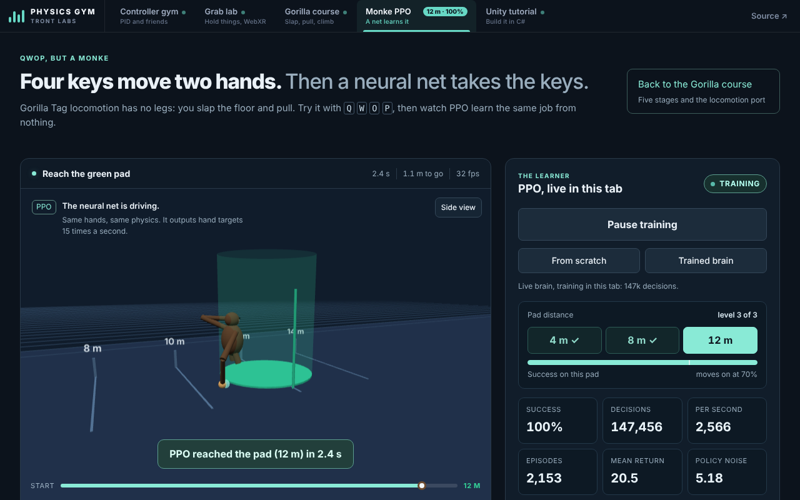

# Physics Gym devlog

Newest first. Each entry says what changed, what was checked, and what is still rough.

## 2026-11-27 · One app, five sections

**Changed**

- `shell.js` puts one tab bar over the Controller gym, Grab lab, Gorilla course, Monke PPO and the Unity tutorial. Every address still works on its own and can be linked or reloaded. The first page you open becomes the host; the others open inside it without a page reload.
- A section you leave stays alive with its frame loop paused, so coming back is instant and the state is where you left it. Monke PPO keeps training in its background thread while you look at something else, and its tab shows the current pad and success rate.
- Monke PPO layout pass: one big Start button, a curriculum bar (4, 8, 12 m with the 70% promotion line), stat tiles, larger sharp graphs with axis labels and a marker where the pad moved, distance posts every 2 m, a progress strip, a smoothed camera, and four bars showing the hand commands coming from your keys or from the net.

**Checked**

- Headless Chromium, software WebGL: direct load of all five addresses, tab switching in every order, back and forward, phone width. No console errors.
- Training started on Monke PPO, left for 40 s on another tab, came back at the 12 m pad with the graphs filled in.
- 56 of 56 Node tests, the simulation check and the deliverables validator pass.

**Rough**

- Not tried on a real phone, Safari, Firefox or in a headset. Headset mode from inside the shell is untested.
- Each section keeps its own WebGL context while alive. Fine on a desktop; unknown on a low-memory phone.
- The Gorilla course still draws the player as spheres and a wire box, not the monke.
- Each section still has its own intro block under the tab bar, so the pages do not yet share one layout.
- Gorilla course and Monke PPO have no headset mode yet.

## 2026-11-27 · Monke PPO

Four-key QWOP-style player and a hand-written PPO that learns stage 1 in the browser. Limiting the policy to four live channels (height and forward per hand) took it from about 20% to 99% success at the 12 m pad in about 30 s of training. It hops more than it walks, and it only has to touch the pad.

## 2026-11-27 · Gorilla course

Port of the default Gorilla Tag locomotion on five short stages with carried cubes and a scripted player (no wall-climb routine yet). Tutorial chapter 14 covers turning the same player into a ConfigurableJoint physics body; that Unity code has not been compiled.
